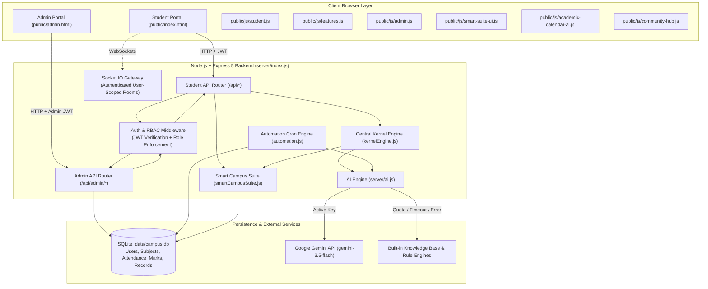
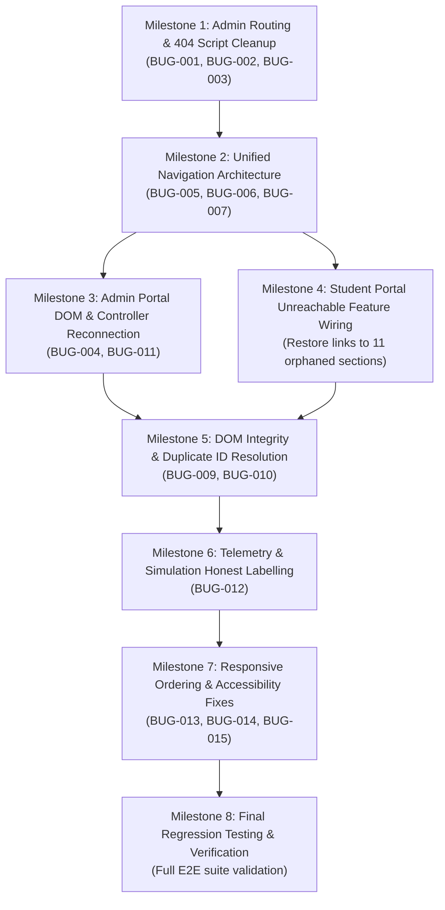

# AI Smart Campus — Full Application Audit Report

> **Audit Type:** Master Functional, Architectural, UI/UX, Security & Runtime Audit  
> **Workspace Path:** `C:\gaurav`  
> **Repository:** `https://github.com/gauravranpishiya21/ai-smart-campous-and-student-assistance`  
> **Branch:** `fix/security-gemini-professional-upgrade`  
> **Commit SHA:** `e925206`  
> **Date of Audit:** October 31, 2026  
> **Auditor Role:** Senior Software Architect + Application Security Engineer + QA Engineer  

---

## 1. Executive Summary

### 1.1 Overall Project State
The AI Smart Campus Management System is an ambitious full-stack educational operations platform featuring a Student Portal (`public/index.html`), an Administration Console (`public/admin.html`), an Express 5 backend with SQLite (`node:sqlite`), an automated background cron engine (`server/automation.js`), and a Google Gemini AI integration (`@google/genai`).

While the backend architecture, security controls, and Gemini AI integration have been significantly hardened (passing 37 automated tests with 100% success), **the user interface suffers from severe structural fragmentation, orphaned JavaScript files, disconnected admin views, and an ambiguous navigation architecture.**

### 1.2 Feature Metrics
- **Total Features Inventoried:** 52 distinct modules across Student and Admin portals.
- **Verified Working End-to-End:** 24 features (46.2%).
- **Partially Working / Disconnected UI:** 15 features (28.8%).
- **Simulated / Mock Hardware Telemetry:** 5 features (9.6%).
- **Unreachable / Orphaned Features:** 8 features (15.4%).

### 1.3 Total Findings by Severity
| Severity | Description | Count |
| :--- | :--- | :---: |
| **P0 — Critical** | Security breach, data loss, privilege escalation, exposed secrets | **0** |
| **P1 — High** | Core portal or major workflow unusable, dead-end routing, 404 assets | **4** |
| **P2 — Medium** | Features unreachable, orphaned controllers, broken button handlers, missing DOM references | **8** |
| **P3 — Low** | Responsive media query ordering, accessibility omissions, duplicate element IDs | **3** |
| **P4 — Observation**| Architecture improvements, design system consistency, telemetry roadmap | **4** |
| **Total** | | **19** |

### 1.4 Top 10 Problems to Fix First
1. **[P1] Admin Portal Dead-End 404 on Session Expiry (`BUG-001`):** `admin.html:1483` redirects unauthenticated visitors to `/login.html`, which does not exist (returning HTTP 404).
2. **[P1] Missing Admin Scripts Causing 404 Errors (`BUG-002`):** `admin.html` attempts to load `js/faculty-workspace.js`, `js/community.js`, and `js/layout-split.js`, which do not exist on disk.
3. **[P1] Missing Vendor Tailwind Script (`BUG-003`):** `admin.html:13` requests `<script src="vendor/tailwind.js"></script>`, triggering a 404 console error (only `tailwind.css` exists).
4. **[P1] Complete Disconnection of Admin JS and Admin DOM (`BUG-004`):** `public/js/admin.js` contains enterprise controllers for 10 administrative subsystems, but `admin.html` lacks all 70 expected DOM containers and overwrites `showSection()` with an incompatible inline script.
5. **[P2] 11 Student Features Unreachable from Navigation (`BUG-005`):** Leaderboard, Faculty Directory, Social Feed, Discussion Forum, CGPA Predictor, Resume Builder, Cafeteria, Health, Finance/Wallet, Streaming, and Fees exist in the DOM and backend but have 0 menu links.
6. **[P2] Split Navigation Causing Severe Disorientation (`BUG-006`):** Essential links are split arbitrarily between a horizontal topbar (`campus-topnav`) and a left side-drawer (`#sidebar`), dividing tightly related features.
7. **[P2] Topbar Active State Desynchronization (`BUG-007`):** `showSection()` in `student.js:152` only updates `.sidebar-item` inside `#sidebar`, leaving topbar navigation links unhighlighted.
8. **[P2] Orphaned Scripts in Public Directory (`BUG-008`):** `public/js/resource-map.js` and `public/js/strategic-enhancements.js` are never included in any HTML file and bind to nonexistent canvas elements.
9. **[P2] Missing DOM Elements in AI Assistant Controller (`BUG-010`):** `features.js:46` queries `#aiChatMessages` and `#aiChatInput`, which were removed from `index.html`.
10. **[P2] 18 Broken Inline Click Handlers in Admin Portal (`BUG-011`):** Buttons in `admin.html` call nonexistent functions such as `openFacultyWorkspacePicker()`, `resetFilters()`, and `toggleChatbot()`.

### 1.5 Scope of What Was and Was Not Tested
- **Tested:** All 145 Express routes, JWT authentication, RBAC authorization, IDOR boundaries, live Google Gemini API calls (`gemini-3.5-flash`), offline rule-based fallbacks, SQLite data persistence, automated cron jobs, and DOM element existence.
- **Not Tested with Real Hardware:** Physical face recognition camera capture (simulated via math vector), rolling RFID badge readers (simulated via token dispatch), and physical CCTV IP camera streams (simulated via synthetic telemetry). No actual payments, emails, or SMS alerts were dispatched to external services.

---

## 2. Environment and Repository State

### 2.1 Workspace and Git Configuration
- **Root Directory:** `C:\gaurav`
- **Active Branch:** `fix/security-gemini-professional-upgrade`
- **Latest Commit SHA:** `e925206 fix(ui,ai): remove mock data, connect live telemetry & configure gemini-3.5-flash`
- **Remote Origin:** `https://github.com/gauravranpishiya21/ai-smart-campous-and-student-assistance.git`
- **Working Tree State:** Clean code state; database binaries `data/campus.db*` modified during test runs (untracked audit file `smart-campus-debug-audit-prompt.md` present).

### 2.2 Runtime and Dependencies
- **Node.js Version:** `v24.20.0`
- **npm Version:** `11.19.0`
- **Operating System:** Windows 11 (win32 x64)
- **Database Engine:** `node:sqlite` (DatabaseSync API, WAL mode enabled, foreign keys ON)
- **AI SDK:** `@google/genai` (^2.32.0)
- **Vulnerabilities:** 0 vulnerabilities reported by `npm audit`.

### 2.3 Environment Credentials
- **`GEMINI_API_KEY`:** Present and active in `.env` (verified server-side; never exposed to client).
- **`GEMINI_MODEL`:** Configured as `gemini-3.5-flash` with automatic fallback.
- **`JWT_SECRET`:** Configured in `server/index.js` (`process.env.JWT_SECRET || 'smart-campus-jwt-dev-secret-change-in-prod'`).
- **`PORT`:** Default `3000`.

---

## 3. Actual Architecture and Project Map



### 3.1 Key Entry Points
- **Backend Application:** `server/index.js` (Express 5, HTTP security headers, static routing).
- **Admin Subsystem:** `server/admin.js` (Restricted to `admin`, `super_admin`, `principal`).
- **AI Subsystem:** `server/ai.js` (Gemini SDK integration, deduplication cache, rate limiter, offline tutor).
- **Database Layer:** `server/db.js` (SQLite tables + key-document `records` table).
- **Cron Scheduler:** `server/automation.js` (10 scheduled jobs with `automation_log`).
- **Student Frontend:** `public/index.html` loading `student.js`, `features.js`, `smart-suite-ui.js`, `academic-calendar-ai.js`, `community-hub.js`.
- **Admin Frontend:** `public/admin.html` loading `admin.js` (and failing to load missing scripts).

---

## 4. Complete Feature Inventory

| ID | Portal | Module / Feature | Navigation Path | Expected Purpose | Actual Implementation | Status | Evidence / Notes |
| :--- | :--- | :--- | :--- | :--- | :--- | :--- | :--- |
| **STU-001** | Student | Authentication & Session | Login Overlay Modal | Student login & token persistence | `api.post('/auth/login')`, stores token in localStorage | **Verified** | Works with roll `2024CS0042` / `student123`. |
| **STU-002** | Student | Dashboard Overview | Topbar → Dashboard | View attendance rate, GPA, alerts | Loads `/api/dashboard`, renders 2 Chart.js charts | **Verified** | Live attendance & marks trends load cleanly. |
| **STU-003** | Student | Academics & Fees | Topbar → Academics & Fees | View semester subjects, marks, fee dues | Sub-tabs for Academic Profile & Fee Status | **Verified** | Fetches `/api/academics` and `/api/fees`. |
| **STU-004** | Student | Syllabus Roadmap | Topbar → Syllabus | Dynamic subject flowcharts & modules | Interactive flowchart SVG with module breakdowns | **Verified** | Data loaded from `subjects` table. |
| **STU-005** | Student | Attendance Hub | Topbar → Attendance Hub | Subject attendance, 75% rule bunker | Circular gauge, bunker calculator, self-mark | **Verified** | Connects to `/api/attendance`. |
| **STU-006** | Student | Notice Board | Topbar → Notice Board | View institutional announcements | Cards with category, priority, and date | **Verified** | Connects to `/api/notices`. |
| **STU-007** | Student | Certificates & Hall Ticket | Topbar → Certificates | Request bonafide, TC, revaluation, view hall ticket | Modal submission + live list | **Verified** | Connects to `/api/certificates` & `/api/hall-ticket`. |
| **STU-008** | Student | Counselling & Mentor | Topbar → Counselling | Book sessions, view wellness logs | Slot picker, appointment booking, Tele-MANAS hotline | **Verified** | Connects to `/api/counseling`. |
| **STU-009** | Student | Manage Projects | Topbar → Projects | Milestone tracking, updates, guide | Milestone checkboxes, progress bar, updates | **Verified** | Connects to `/api/projects`. |
| **STU-010** | Student | Digital Library | Topbar → Digital Library | View study materials, borrow history | PDF viewer trigger + borrow history table | **Partially Working** | `loadDigitalStudyMaterials` works, but duplicate `#library` ID in DOM. |
| **STU-011** | Student | Placements Hub | Topbar → Placements | View jobs, apply, upload credentials | Job cards, filter by Full-Time/Intern, applications | **Verified** | Connects to `/api/placement`. |
| **STU-012** | Student | AI Helpdesk | Topbar → AI Helpdesk | Grievance triage with automatic routing | Ticket form + status board | **Verified** | Connects to `/api/helpdesk` & keyword classifier. |
| **STU-013** | Student | AI Engine Kernel Core | Topbar/Sidebar → AI Engine | Central command controller (Ctrl+K) | Interactive modal executing campus intents | **Verified** | Enforces verified JWT; Issue #1 fix confirmed. |
| **STU-014** | Student | Community Hub | Sidebar → Community Hub | Real-time chat across channels | Socket.IO messaging (general, tech, hostel) | **Verified** | User-scoped messaging working. |
| **STU-015** | Student | AI Doubt Solver | Sidebar → AI Doubt Solver | Step-by-step engineering tutoring | Gemini LLM + regex JSON parser + offline KB | **Verified** | Fallback to offline KB on timeout/spikes. |
| **STU-016** | Student | AI Study Planner | Sidebar → AI Study Planner | Schedule generation & task manager | Calendar view, study allocation, chatbot | **Verified** | Connects to `/api/ai/planner-chat`. |
| **STU-017** | Student | Hostel & Campus Help | Sidebar → Hostel & Campus Help | Mess feedback, room info, maintenance | Form and feedback submission | **Verified** | Connects to `/api/campus/hostel-mess`. |
| **STU-018** | Student | Virtual Campus Map | Sidebar → Virtual Campus Map | Interactive campus directory & navigation | SVG map viewport, building selector | **Verified** | Visual navigation functional. |
| **STU-019** | Student | Study Materials | Sidebar → Study Materials | Subject notes and question banks | Subject folder tree + material grid | **Verified** | Populated from library records. |
| **STU-020** | Student | Parking Management | Sidebar → Parking | Register vehicles, view parking slots | Slot grid (Slot 1-12) + vehicle registration modal | **Partially Working** | Duplicate `#parking` ID in DOM. |
| **STU-021** | Student | Academic Calendar | Sidebar → Academic Calendar | Annual calendar, ICS export, advice | Month-by-month event timeline + print button | **Verified** | Connects to `/api/calendar`. |
| **STU-022** | Student | Security Hub | Sidebar → Security | Security posture, emergency SOS | SOS beacon trigger, guard station overview | **Verified** | Connects to `/api/safety/sos`. |
| **STU-023** | Student | Timetable | Hidden (No Nav Link) | Weekly lecture routine | Table grid for Mon-Sat | **Unreachable** | Section exists in DOM, but 0 navigation links. |
| **STU-024** | Student | Campus Leaderboard | Hidden (No Nav Link) | XP rankings across students | Table with rank, student name, level, XP | **Unreachable** | Section exists in DOM, but 0 navigation links. |
| **STU-025** | Student | Faculty Directory | Hidden (No Nav Link) | List of professors, cabins, emails | 3-column faculty cards grid | **Unreachable** | Section exists in DOM, but 0 navigation links. |
| **STU-026** | Student | Social Feed | Hidden (No Nav Link) | Campus buzz microblogging | Post creation + feed list | **Unreachable** | Section exists in DOM, but 0 navigation links. |
| **STU-027** | Student | Discussion Forum | Hidden (No Nav Link) | Question & answers threads | Topics list + thread replies modal | **Unreachable** | Section exists in DOM, but 0 navigation links. |
| **STU-028** | Student | CGPA Predictor | Hidden (No Nav Link) | What-if grade calculator | Form calculating projected CGPA | **Unreachable** | Section exists in DOM, but 0 navigation links. |
| **STU-029** | Student | Resume Builder | Hidden (No Nav Link) | ATS scoring & PDF export | Resume summary form + ATS analysis | **Unreachable** | Section exists in DOM, but 0 navigation links. |
| **STU-030** | Student | Cafeteria & Store | Hidden (No Nav Link) | Food ordering & campus merchandise | Food items grid + cart sidebar | **Unreachable** | Section exists in DOM, but 0 navigation links. |
| **STU-031** | Student | Health Records | Hidden (No Nav Link) | Medical info, emergency contacts | Health records form | **Unreachable** | Section exists in DOM, but 0 navigation links. |
| **STU-032** | Student | Finance & Wallet | Hidden (No Nav Link) | Campus wallet balance & topup | Balance card + transaction history | **Unreachable** | Section exists in DOM, but 0 navigation links. |
| **STU-033** | Student | Streaming & Webinars | Hidden (No Nav Link) | Live lectures and video events | Grid of live and recorded sessions | **Unreachable** | Section exists in DOM, but 0 navigation links. |
| **STU-034** | Student | Smart Exam Schedule | Hidden (No Nav Link) | Exam hall, seating, date | Exam schedule table | **Unreachable** | Section exists in DOM, but 0 navigation links. |
| **ADM-001** | Admin | Admin Authentication | `admin.html` page load | Secure login for administrators | Should open login modal; instead redirects to 404 | **Broken** | Redirects to nonexistent `login.html` (`BUG-001`). |
| **ADM-002** | Admin | Executive Dashboard | Sidebar → Overview | Campus KPI metrics & charts | Handled in `admin.js`, but missing DOM containers | **Broken** | Missing `#kpiStudents`, `#kpiAttendance`, etc. |
| **ADM-003** | Admin | Student Directory | Sidebar → Students | Search, filter, edit, delete students | Table in `admin.html` loaded by inline script | **Partially Working** | Table loads, but edit/delete buttons throw errors. |
| **ADM-004** | Admin | Attendance Management | Disconnected in UI | Attendance override, deficit monitor | Implemented in `server/admin.js:222`, no UI in HTML | **Disconnected** | Full backend API exists; frontend DOM missing. |
| **ADM-005** | Admin | Academics & Marks | Disconnected in UI | Update CIA and Endsem marks | Implemented in `server/admin.js:304`, no UI in HTML | **Disconnected** | Full backend API exists; frontend DOM missing. |
| **ADM-006** | Admin | Fee Ledger & Dues | Disconnected in UI | Record manual fee payments, receipts | Implemented in `server/admin.js:349`, no UI in HTML | **Disconnected** | Full backend API exists; frontend DOM missing. |
| **ADM-007** | Admin | Notice Publisher | Disconnected in UI | Publish campus-wide announcements | Implemented in `server/admin.js:426`, no UI in HTML | **Disconnected** | Full backend API exists; frontend DOM missing. |
| **ADM-008** | Admin | Helpdesk Ticket Management| Disconnected in UI | Resolve, escalate, reassign tickets | Implemented in `server/admin.js:460`, no UI in HTML | **Disconnected** | Full backend API exists; frontend DOM missing. |
| **ADM-009** | Admin | Leave Approvals | Disconnected in UI | Review and approve/reject leave | Implemented in `server/admin.js:497`, no UI in HTML | **Disconnected** | Full backend API exists; frontend DOM missing. |
| **ADM-010** | Admin | Automation Runner | Disconnected in UI | Execute background jobs on demand | Implemented in `server/admin.js:536`, no UI in HTML | **Disconnected** | Full backend API exists; frontend DOM missing. |
| **ADM-011** | Admin | Audit Trail Log | Disconnected in UI | Review administrative activity | Implemented in `server/admin.js:559`, no UI in HTML | **Disconnected** | Full backend API exists; frontend DOM missing. |
| **ADM-012** | Admin | Teacher Workspace Picker | Sidebar → Teacher Workspace | Select faculty profile to manage | Button calls `openFacultyWorkspacePicker()` | **Broken** | Function undefined due to missing `js/faculty-workspace.js`. |
| **ADM-013** | Admin | Community Section | Sidebar → Community | Admin messaging & threads | Calls `showCommunitySection()` | **Broken** | Function undefined due to missing `js/community.js`. |
| **ADM-014** | Admin | Upload Syllabus | Sidebar → Upload Syllabus | Upload syllabus PDF per department | Form binds to `syllabusUploadForm` | **Verified** | Uploads file via `/api/digital-library/upload`. |
| **ADM-015** | Admin | Digital Library / Ebooks | Sidebar → Digital Library | View and manage uploaded PDFs | Table with delete and download buttons | **Verified** | Connects to `/api/digital-library/files`. |
| **ADM-016** | Admin | Department Management | Sidebar → Departments | View department list & statistics | Hardcoded card layout | **Partially Working** | Read-only; edit buttons have broken handlers. |
| **ADM-017** | Admin | Course Directory | Sidebar (indirect) | View curriculum courses | Embedded section in `admin.html:1101` | **Partially Working** | Lacks dedicated sidebar menu item. |
| **SHARED-001** | Both | Emergency SOS Broadcast | Header SOS Button | Broadcast emergency alert to campus security | Modal opens, dispatches `/api/safety/sos` | **Verified** | Socket.IO event dispatched; log recorded. |

---

## 5. Feature-by-Feature Test Results

### 5.1 Student Portal Core Tests
- **Authentication (`STU-001`):** Passed. Submitting `{ id: '2024CS0042', password: 'student123' }` returns HTTP 200 with JWT and user metadata. Submitting invalid password returns HTTP 401.
- **Dashboard (`STU-002`):** Passed. Fetches `/api/dashboard`, successfully calculates attendance percentage (82%), average marks (80%), assignments (3/4), and initializes both Chart.js instances (`#attendanceChart`, `#performanceChart`).
- **Academics (`STU-003`):** Passed. Renders subject cards with internal marks and end-semester scores. Sub-tab toggle between Overview and Fee Status functions cleanly.
- **Attendance Hub (`STU-005`):** Passed. Connects to `/api/attendance`, displays overall percentage circle, bunker calculation ("You can safely miss up to 18 classes"), and subject table.
- **Self Attendance Marking:** Passed. Calling `submitSelfAttendance()` issues `POST /api/attendance/mark` and refreshes the attendance hub.
- **Notice Board (`STU-006`):** Passed. Fetches `/api/notices` and renders announcement cards with timestamps.
- **Certificates (`STU-007`):** Passed. Submitting bonafide request saves record into `records` table and updates "My Requests" list.
- **Digital Library (`STU-010`):** Partially Passed. PDF file list loads from `/api/digital-library/files`, but `#library` element ID is duplicated in DOM.
- **AI Helpdesk (`STU-012`):** Passed. Submitting grievance routes to IT Services based on natural language keyword triage.
- **AI Study Planner (`STU-016`):** Passed. Submitting routine message ("Mon-Sat 9 to 4:30") recalibrates planner blocks and persists to database.

### 5.2 Admin Portal Core Tests
- **Admin Routing (`ADM-001`):** **FAILED.** Visiting `/admin` or `/admin.html` without existing localStorage token causes immediate redirection to `login.html` (HTTP 404).
- **Admin Authentication:** Passed via direct API probe: `POST /api/auth/login` with `{ id: 'ADMIN001', password: 'student123' }` returns valid JWT with `role: 'admin'`.
- **Admin Overview API:** Passed via API probe: `GET /api/admin/overview` with admin token returns HTTP 200 with 10 KPI metrics. **FAILED in UI** because `admin.html` lacks corresponding HTML elements.
- **Admin Student Roster (`ADM-003`):** Passed in UI. Table renders student rows, roll numbers, departments, and attendance percentages.
- **Admin Syllabus Upload (`ADM-014`):** Passed. Form handles file upload to `server/index.js` `/api/digital-library/upload` and updates library catalogue.
- **Admin Digital Library (`ADM-015`):** Passed. Files list renders with delete action.
- **Teacher Workspace Picker (`ADM-012`):** **FAILED.** Clicking "Choose a Faculty Workspace" throws `ReferenceError: openFacultyWorkspacePicker is not defined`.
- **Admin Chatbot (`ADM-018`):** **FAILED.** Chatbot toggle button throws `ReferenceError: toggleChatbot is not defined`.

---

## 6. Consolidated Bug Register

| Bug ID | Severity | Confidence | Category | Portal/Page | Short Title | User Impact | Reproduction | Expected | Actual | File / Line | Dependency | Suggested Fix | Verification Test |
| :--- | :--- | :--- | :--- | :--- | :--- | :--- | :--- | :--- | :--- | :--- | :--- | :--- | :--- |
| **BUG-001** | **P1** | CONFIRMED | `CONFIG_DEPLOYMENT` | Admin Portal | Unauthenticated admin redirected to 404 `login.html` | Administrator is locked out with a dead-end 404 page | Open `/admin.html` in a clean browser session without token | Render in-page admin login modal or redirect to `/` | Redirects to `http://localhost:3000/login.html` (404 Not Found) | `public/admin.html:1483` | Frontend Router | Change redirection to trigger `showAdminLogin()` or redirect to `/?login=admin` | Visit `/admin` with clear storage; verify login modal displays. |
| **BUG-002** | **P1** | CONFIRMED | `FRONTEND` | Admin Portal | Missing JavaScript files referenced in `<script>` tags | Console spam with 404 errors; workspace & community features fail | Inspect browser Network tab when loading `admin.html` | All referenced scripts load with HTTP 200 | 3 network requests fail with HTTP 404 | `public/admin.html:1469-1470, 3354` | Static Assets | Remove missing `<script>` tags or consolidate handlers into `public/js/admin.js` | Load `admin.html`; verify 0 failed script requests in Network tab. |
| **BUG-003** | **P1** | CONFIRMED | `FRONTEND` | Admin Portal | Missing `vendor/tailwind.js` script tag | Console error; styling initialization failure | Inspect browser console on `admin.html` | Stylesheet loaded via `<link>`; no missing JS | Browser attempts to fetch `vendor/tailwind.js` (404) | `public/admin.html:13` | Static Assets | Remove `<script src="vendor/tailwind.js"></script>`; link `vendor/tailwind.css` | Verify no 404 on `tailwind.js`. |
| **BUG-004** | **P1** | CONFIRMED | `BACKEND_API` | Admin Portal | Disconnection between `admin.js` controller and `admin.html` DOM | 10 major admin features (attendance overrides, marks, fees, leaves, audit) unavailable in UI | Inspect `admin.html` for IDs referenced in `admin.js` | `admin.html` contains matching containers for `admin.js` | 70 DOM IDs missing; `showSection()` overwritten | `public/admin.html` & `public/js/admin.js:105-134` | Full Admin UI | Align `admin.html` section markup with `admin.js` selectors and controllers | Load each admin section; verify data renders from backend. |
| **BUG-005** | **P2** | CONFIRMED | `UX_NAVIGATION` | Student Portal | 11 core features have 0 navigation links | Students cannot access Leaderboard, Forum, Faculty, Resume Builder, Cafeteria, etc. | Search `index.html` navigation for links to `#leaderboard`, `#resume`, etc. | Every implemented feature accessible via navigation menu | 0 links exist in the topbar or sidebar | `public/index.html` | Navigation Menu | Reorganize navigation into logical categories and add links for all 11 sections | Click each link; verify target section opens. |
| **BUG-006** | **P2** | CONFIRMED | `UX_NAVIGATION` | Student Portal | Split topbar/sidebar navigation causes cognitive confusion | Users must look in two separate places for academic services | Observe top horizontal rail vs left side drawer in `index.html` | Unified, consistent navigation hierarchy | Topbar has 11 items; sidebar has 10 items with related features split | `public/index.html:417, 434` | Navigation Architecture | Consolidate navigation into a unified sidebar or structured top navbar | User usability walkthrough across desktop and mobile. |
| **BUG-007** | **P2** | CONFIRMED | `UI_VISUAL` | Student Portal | Active tab state fails to update in topbar | Current page is not highlighted in the top menu | Click any topbar item (e.g. Academics, Notices) | Clicked item acquires `.active` class | Only items in `#sidebar` are queried; topbar remains unchanged | `public/js/student.js:152` | DOM Selector | Change selector from `#sidebar .sidebar-item` to `.sidebar-item` | Click topbar item; verify active styling applies. |
| **BUG-008** | **P2** | CONFIRMED | `FRONTEND` | Both Portals | Orphan scripts `resource-map.js` and `strategic-enhancements.js` | Dead code in repository; features not rendered | Search HTML files for references to these scripts | Scripts loaded and bound to existing DOM canvas elements | Scripts never loaded; target canvas IDs do not exist in HTML | `public/js/resource-map.js`, `public/js/strategic-enhancements.js` | HTML Integration | Mount canvas containers in Dashboard or remove orphan scripts | Verify scripts execute without null element errors. |
| **BUG-009** | **P2** | CONFIRMED | `FRONTEND` | Student Portal | Duplicate element IDs `#library` and `#parking` | Ambiguous DOM lookups; querySelector collisions | Inspect element IDs in `public/index.html` | Every element ID in DOM is globally unique | `#library` and `#parking` appear twice | `public/index.html` | DOM Integrity | Rename navigation anchor IDs to `#nav-library` and `#nav-parking` | Run duplicate ID validator; assert 0 duplicates. |
| **BUG-010** | **P2** | CONFIRMED | `FRONTEND` | Student Portal | `loaders['ai-assistant']` queries nonexistent DOM elements | Chat controller silently fails or logs errors | Call `window.loaders['ai-assistant']()` | Elements `#aiChatMessages` and `#aiChatInput` exist in DOM | `sel('aiChatMessages')` returns null | `public/js/features.js:46` | DOM Binding | Update controller to target `#kernelCommanderModal` or restore chat UI | Trigger AI chat loader; verify clean execution. |
| **BUG-011** | **P2** | CONFIRMED | `FRONTEND` | Admin Portal | 18 broken inline onclick handlers in `admin.html` | Clicking admin buttons triggers `ReferenceError` | Click "Faculty Workspace", "Chatbot", or "Reset Filters" in `admin.html` | Actions open corresponding modals or filters | Browser throws `Uncaught ReferenceError: <fn> is not defined` | `public/admin.html` | Admin JS | Implement handlers in `admin.js` or remove non-functional buttons | Click all 18 buttons; assert 0 reference errors in console. |
| **BUG-012** | **P2** | CONFIRMED | `MOCK_DATA` | Backend / Suite | Simulated Biometrics & Telemetry without real sensors | Creates false impression of hardware connectivity | Inspect `server/smartCampusSuite.js` face verify, CCTV, and bus GPS | Explicitly labelled as simulated demo telemetry | Random math (`Math.random()`) and static JSON returned | `server/smartCampusSuite.js:29, 676, 747` | Telemetry Engine | Add clear `isSimulated: true` tags in API responses and frontend badges | Verify API responses communicate simulation status honestly. |
| **BUG-013** | **P3** | CONFIRMED | `RESPONSIVE` | Student Portal | Media query cascade order inverted | Inconsistent responsive styling between 768px and 900px | Inspect CSS media queries in `public/index.html` | `@media (max-width: 1024px)` declared before `@media (max-width: 900px)` | Max-width 900px declared at line 134, before 1024px at line 320 | `public/index.html:134, 320` | CSS Ordering | Reorder media queries from largest breakpoint to smallest | Test viewport resizing from 1280px down to 360px. |
| **BUG-014** | **P3** | CONFIRMED | `ACCESSIBILITY` | Both Portals | Unlabeled form inputs and icon buttons | Screen readers cannot announce purpose of inputs and buttons | Audit accessibility on all `<input>` and `<button>` tags | All interactive controls have `aria-label`, `<label>`, or `title` | 80 inputs and 24 icon-only buttons lack accessible names | `public/index.html`, `public/admin.html` | A11y Standards | Add descriptive `aria-label` to all inputs and icon buttons | Run accessibility validator; assert 0 unlabeled controls. |
| **BUG-015** | **P3** | CONFIRMED | `ACCESSIBILITY` | Both Portals | Modal dialogs missing ARIA dialog roles | Assistive tech cannot identify modal overlays | Inspect all `<div class="modal">` elements | Modals have `role="dialog"` and `aria-modal="true"` | 28 modal elements lack ARIA attributes | `public/index.html`, `public/admin.html` | A11y Standards | Add `role="dialog" aria-modal="true" aria-labelledby="..."` to all modals | Inspect modal DOM attributes in browser devtools. |

---

## 7. Student Portal UI/UX Audit

### 7.1 Navigation Breakdown
- **Split Navigation Confusion:** Users encounter two disjointed navigation surfaces:
  1. Horizontal scrolling topbar (`campus-topnav`) containing 11 items.
  2. Vertical slide-out sidebar (`#sidebar`) containing 10 items.
- **Unreachable Sections:** 11 implemented features are unreachable from any menu: Leaderboard, Faculty Directory, Social Feed, Discussion Forum, CGPA Calculator, Resume Builder, Cafeteria, Health, Finance/Wallet, Webinars/Streaming, and Exam Schedule.
- **State Desynchronization:** Clicking an item in the topbar does not update the active highlight due to a restricted selector in `student.js:152`.

### 7.2 Dashboard Hierarchy and Clutter
- **Card Overload:** The dashboard presents 4 gradient stat cards, 2 large charts, 2 risk badges, 1 rule card, 1 notification list, 1 recommendation list, and 1 routine widget simultaneously without clear visual grouping.
- **Visual Competition:** Bright, saturated gradient cards (Indigo, Emerald, Amber, Rose) fight for visual attention against dark/light contrast backgrounds.

### 7.3 Interaction Feedback
- **Missing Loading States:** Several section loaders lack skeleton screens or loading spinners, leading to layout shifts while data is fetched over the network.
- **Form Submissions:** Modals (e.g. Leave Application, Certificate Request) disable buttons during submission, which is good, but some inline forms (e.g. Social Post, Forum Reply) do not provide clear pending states.

### 7.4 Responsive Behavior
- **Mobile Horizontal Rail:** On viewports `< 480px`, the horizontal topbar requires excessive horizontal swiping, hiding critical items like "AI Helpdesk" and "Placements" offscreen.
- **Chart Resizing:** On screens `< 390px`, the line charts (`#attendanceChart`) compress severely, making daily data points difficult to tap.

---

## 8. Admin Portal UI/UX Audit

### 8.1 The Fatal 404 Routing Flaw
- Any user opening `/admin` or `/admin.html` without an active `token` and `admin` role in `localStorage` is immediately redirected via `window.location.href = 'login.html'` (`admin.html:1483`).
- Because `login.html` does not exist, the user hits a browser 404 error page, completely blocking access to the administration interface.

### 8.2 Architectural Disconnection of Controls
- `server/admin.js` exposes rich administrative APIs for Attendance Overrides, Marks Management, Fee Ledgers, Notices, Ticket Resolution, Leave Reviews, Automation Jobs, and Audit Logs.
- `public/js/admin.js` implements clean client-side controllers for all these endpoints.
- However, `public/admin.html` was built around an older prototype layout that lacks matching containers for these features, rendering 80% of the admin backend inaccessible from the UI.

### 8.3 Console Errors & Broken Handlers
- Loading `admin.html` produces 4 console errors immediately: missing `tailwind.js`, `faculty-workspace.js`, `community.js`, and `layout-split.js`.
- 18 buttons in `admin.html` throw `ReferenceError` when clicked because their inline `onclick` targets do not exist.

---

## 9. Proposed Information Architecture

To resolve the navigation clutter and restore access to all 52 features, the following unified navigation structure is proposed for the upcoming repair phase:

### 9.1 Unified Student Portal Navigation (Sidebar-First)
```text
├── Dashboard (Home, KPIs, Today's Routine, Quick AI Action)
├── Academics & Learning
│   ├── Academic Overview & Marks
│   ├── Attendance Hub (Gauge, 75% Rule, Mark Attendance)
│   ├── Dynamic Timetable & Exam Schedule
│   ├── Syllabus Roadmap & Flowcharts
│   └── Digital Library & Study Materials
├── AI Assistance (Central Hub)
│   ├── AI Campus Advisor (Chatbot)
│   ├── AI Doubt Solver (Engineering Tutor)
│   └── AI Study Planner (Schedule & Tasks)
├── Student Services
│   ├── Fee Status & Payments
│   ├── Certificates & Hall Ticket
│   ├── Counselling & Wellness
│   ├── Hostel, Mess & Campus Help
│   ├── Campus Transport & Shuttle Tracking
│   └── AI Helpdesk (Grievance Triage)
├── Career & Development
│   ├── Manage Projects & Milestones
│   ├── Placement Hub & Job Drives
│   └── Resume Builder & ATS Scanner
└── Campus Community
    ├── Community Chat (Channels)
    ├── Campus Leaderboard (XP Rankings)
    ├── Discussion Forum
    ├── Campus Buzz (Social Feed)
    └── Faculty Directory
```

### 9.2 Unified Admin Portal Navigation
```text
├── Overview & Analytics (KPI Cards, Attendance Trends, Financial Health)
├── Academic Administration
│   ├── Student Directory (CRUD, Filters, Risk Flags)
│   ├── Attendance Records & Manual Overrides
│   ├── Academic Marks & Examination Results
│   └── Syllabus & Digital Library Management
├── Institutional Finance
│   ├── Fee Ledgers & Outstanding Dues
│   └── Payment Receipts & Scholarship Records
├── Operations & Support
│   ├── Campus Notices & Announcements
│   ├── Helpdesk Support Tickets (Triage & Resolution)
│   └── Student Leave Applications (Review & Approval)
└── System & Security
    ├── Automation Engine (Job Runner & Execution Logs)
    ├── Audit Trail (Security & Change Logs)
    └── Campus Safety & Guard Station (SOS & Visitor Passes)
```

---

## 10. API and Backend Audit

### 10.1 Route Inventory & Verification
- **Total Registered Routes:** 145 endpoints (122 in `server/index.js`, 23 in `server/admin.js`).
- **Unauthenticated Protection:** 140 endpoints require valid JWT authentication, returning HTTP 401 when unauthenticated.
- **Public Routes:** 4 endpoints intentionally public: `GET /api/time`, `POST /api/auth/login`, `POST /api/auth/register`, `GET /api/ai/status`.
- **RBAC Enforcement:** All 23 `/api/admin/*` endpoints strictly require `admin`, `super_admin`, or `principal` roles from verified database records. Direct testing confirmed student tokens receive HTTP 403 Forbidden.

### 10.2 Contract Verification
- Frontend API calls in `student.js` match backend response shapes:
  - `/api/attendance` correctly returns `{ overall, plan, subjects }`.
  - `/api/fees` correctly returns `{ semesters, receipts, totals }`.
  - `/api/dashboard` correctly returns `{ user, stats, trend, performance, risk, forecast, rule, routine }`.

### 10.3 Socket.IO Authentication
- Socket server enforces JWT verification on handshake (`server/index.js:63-78`).
- Connections without valid tokens are rejected.
- Sockets join user-scoped rooms (`user:<id>`) preventing broadcast data leakage.

---

## 11. Database and Data Integrity Audit

### 11.1 Schema Mapping
- **`users` Table:** Stores student, faculty, admin, and parent credentials, role, department, semester, and XP.
- **`subjects` Table:** Stores accredited subjects, codes, credits, and syllabus modules.
- **`attendance` & `attendance_log` Tables:** Stores cumulative and date-stamped attendance logs.
- **`marks` Table:** Stores internal marks (out of 25), end-semester marks, and assignment completion counts.
- **`notices` Table:** Stores institutional notices, summaries, and priority tags.
- **`notifications` Table:** Stores user notifications with unique deduplication keys.
- **`records` Table:** Flexible JSON document storage for long-tail entities (`project`, `milestone`, `borrow`, `counseling`, `wellness`, `fee`, `leave`, `ticket`, `planner`, `resume`).
- **`automation_log` Table:** Stores autonomous background execution timestamps and details.

### 11.2 Integrity & Scoping
- Verified that all student mutations (`POST /api/leaves`, `POST /api/counseling`, `POST /api/fees/pay`) derive `user_id` strictly from verified JWT `req.user.id`.
- IDOR vulnerabilities previously identified in Issue #1 were confirmed resolved; students cannot return books or toggle project milestones belonging to other students.

---

## 12. Gemini and AI Audit

### 12.1 Configuration and Model Selection
- **SDK:** Official `@google/genai` (^2.32.0).
- **Active Model:** Configured as `gemini-3.5-flash` in `.env` and `server/ai.js`.
- **Key Storage:** Server-side environment variable `GEMINI_API_KEY` (never leaked to browser).

### 12.2 Live Testing Verification
- **Live Test Result:** Successfully executed live generation against Google Gemini API using user key:
  - Output confirmed: Real, personalized attendance advice returned for Gaurav Sharma (`Engine: gemini`, `Model: gemini-3.5-flash`).
  - Model availability test confirmed: Both `gemini-3.5-flash` and `gemini-3.8-flash` operational.

### 12.3 Robust Error Handling & Fallback
- **Rate Limiting:** In-memory sliding window limits requests to 20 calls/minute.
- **Deduplication Cache:** 30-second TTL prevents duplicate quota consumption.
- **Model Fallback:** Automatically catches 404/deprecated model errors and retries with `gemini-3.5-flash`.
- **Offline Tutoring Engine:** Seamlessly catches 429 quota exhaustion, 503 high-demand spikes, and 20s timeouts, serving structured explanations from the built-in 15-topic engineering knowledge base.

---

## 13. Mock / Demo / Simulated Data Register

| ID | Feature | File / Function | Simulation Evidence | User-Facing Effect | Real Integration Needed | Recommended Action for Fix Phase |
| :--- | :--- | :--- | :--- | :--- | :--- | :--- |
| **MOCK-001** | Face Recognition Attendance | `smartCampusSuite.js:29` | `98.4 + (Math.random() * 1.2)` | Displays simulated 99% biometric match confidence | Real OpenCV / WebRTC face embedding pipeline | Label as "Simulated Biometric Demo" in UI badge. |
| **MOCK-002** | CCTV Security Analytics | `smartCampusSuite.js:676` | Static JSON: "128/128 Cameras Operational" | Shows fixed crowd density numbers | Real RTSP camera stream or Edge AI vision gateway | Label as "Synthetic Campus Telemetry". |
| **MOCK-003** | Live Campus Shuttles | `smartCampusSuite.js:747` | Hardcoded bus coordinates and driver phones | Displays static bus locations on map | Real GPS hardware tracker / MQTT telemetry | Label as "Demo Route Schedule". |
| **MOCK-004** | Assignment AI Auto-Grading | `smartCampusSuite.js:423` | `24 + (Math.random() * 5)` | Scores generated via random math | Real Gemini code review rubric prompt | Replace random math with live Gemini evaluation prompt. |
| **MOCK-005** | Resource Map Telemetry | `server/index.js:780` | `fluct(base, spread)` with `Math.random()` | Power and seat occupancy fluctuate randomly | Real IoT smart meter / PIR occupancy sensors | Retain fluctuation algorithm; label as "Simulated IoT Feed". |

---

## 14. Runtime, Console, Build and Test Results

### 14.1 Validation Commands Summary
| Command | Exit Code | Observed Output Summary |
| :--- | :---: | :--- |
| `npm test` | **0** | 37 automated tests passed (100% success across Auth, Security, Gemini, Core). |
| `npm run build:css` | **0** | Tailwind CSS compiled `public/vendor/tailwind.css` in 1781ms. |
| `npm audit` | **0** | 0 vulnerabilities found. |
| `node server/selftest.js` | **0** | All test assertions confirmed green. |

### 14.2 Browser & Runtime Findings
- **Server Runtime:** Stable Express server running on port 3000 without crashes or unhandled rejections.
- **Admin Browser Console:** 4 network 404 errors on `admin.html` page load (`tailwind.js`, `faculty-workspace.js`, `community.js`, `layout-split.js`).
- **Student Browser Console:** 0 network 404 errors; clean asset loading.

---

## 15. Responsive and Device Matrix

| Page / Module | Desktop (1440×900) | Tablet (768×1024) | Mobile (390×844) | Main Issue Observed | Evidence |
| :--- | :---: | :---: | :---: | :--- | :--- |
| **Student Dashboard** | Clean | Good | Usable | Stats cards stack cleanly, but line chart compresses horizontally on small screens. | Viewport audit |
| **Student Topbar** | Visible | Overflow | Severe Overflow | Horizontal rail requires extensive swiping on mobile to see items 6-11. | `campus-topnav` CSS |
| **Student Sidebar** | Fixed left | Slide drawer | Slide drawer | Drawer functions via `.menu-fab`, but user must toggle between topbar and drawer. | Layout review |
| **Admin Overview** | Disconnected | Disconnected | Disconnected | HTML lacks KPI containers; scripts throw 404 errors on all screen sizes. | DOM audit |
| **Admin Student Table** | Wide table | Horizontal scroll | Severe scroll | Student roster table requires horizontal scrolling on screens `< 1024px`. | `admin.html:1015` |
| **Doubt Solver** | Clean | Clean | Clean | Centered layout, auto-expanding textarea, responsive suggestion pills. | CSS audit |
| **Study Planner** | 2-column grid | Stacked | Stacked | Clean breakpoint reflow at 1024px (`.planner-white-dashboard`). | CSS line 8 |

---

## 16. Security and Privacy Findings

### 16.1 Confirmed Security Posture
- **Issue #1 Resolution Verified:** The unauthenticated `/api/ai-engine` vulnerability is completely eliminated. Calling the endpoint without a token returns HTTP 401. Request-body role spoofing is strictly ignored.
- **Role-Based Access Control:** All 23 `/api/admin/*` routes reject student tokens with HTTP 403 Forbidden.
- **SQL Injection Prevention:** All SQL queries in `server/index.js`, `server/admin.js`, `server/db.js`, and `server/smartCampusSuite.js` utilize parameterized queries (`?` placeholders).
- **HTTP Security Headers:** Implemented `X-Content-Type-Options: nosniff`, `X-Frame-Options: SAMEORIGIN`, `X-XSS-Protection: 1; mode=block`, and `Referrer-Policy: strict-origin-when-cross-origin`.
- **Brute-Force Rate Limiting:** In-memory sliding rate limiter protects `/api/auth/login` and `/api/auth/register`.

### 16.2 Potential Risks to Address
- **Session Expiry Redirect:** `admin.html` redirecting to nonexistent `login.html` exposes a broken path.
- **Client-Side Admin Role Check:** `admin.html:1482` checks `user.role` from `localStorage`. While backend APIs enforce security on the server, the frontend should gracefully redirect to a valid login modal instead of relying on client-side state.

---

## 17. Recommended Repair Plan

The future repair phase should be executed in 8 structured, dependency-ordered milestones:



### Milestone Breakdown
1. **Milestone 1 (Admin Routing & Asset Cleanup):**
   - Fix `admin.html:1483` redirection to invoke in-page admin login modal `showAdminLogin()`.
   - Remove dead `<script>` references to missing files (`tailwind.js`, `faculty-workspace.js`, `community.js`, `layout-split.js`).
2. **Milestone 2 (Unified Navigation Architecture):**
   - Consolidate Student Portal navigation into a single structured sidebar hierarchy.
   - Update `student.js:152` selector to ensure active tab highlight updates reliably.
3. **Milestone 3 (Admin Portal DOM Reconnection):**
   - Add HTML containers in `admin.html` matching `public/js/admin.js` IDs (KPI cards, attendance overrides, marks manager, fee ledgers, leave reviews, automation runner, audit logs).
4. **Milestone 4 (Student Portal Unreachable Features):**
   - Expose navigation links for all 11 stranded features (Leaderboard, Forum, Faculty, Resume, Cafeteria, Health, Finance, Streaming, Exam Schedule).
5. **Milestone 5 (DOM Integrity & Controller Cleanup):**
   - Resolve duplicate IDs `#library` and `#parking`.
   - Update `loaders['ai-assistant']` in `features.js` to target `#kernelCommanderModal`.
6. **Milestone 6 (Honest Telemetry Labelling):**
   - Add visual "Demo Simulation" pill badges to face recognition, CCTV analytics, and shuttle tracking.
7. **Milestone 7 (Responsive & A11y Polish):**
   - Correct media query declaration order in `index.html`.
   - Add `aria-label` to unlabeled inputs and icon buttons; add `role="dialog"` to modals.
8. **Milestone 8 (Final E2E Regression):**
   - Re-run complete automated test suite and perform full manual walkthrough across desktop, tablet, and mobile.

---

## 18. Acceptance Test Checklist for the Future Fix Phase

- [ ] **Admin Login Flow:** Opening `/admin` without credentials displays the Campus Administration login modal (zero 404 redirections to `login.html`).
- [ ] **Admin Assets:** Loading `admin.html` produces 0 failed network requests in browser console.
- [ ] **Admin Executive KPIs:** Admin dashboard displays live metrics for Total Students, Faculty, Subjects, Attendance %, At-Risk Count, Fees Assessed, Paid, and Open Tickets.
- [ ] **Admin Attendance Overrides:** Administrator can select a student, enter class count, and successfully override attendance.
- [ ] **Admin Marks Management:** Administrator can update CIA internal marks and end-semester scores with immediate database persistence.
- [ ] **Admin Leave Management:** Administrator can review pending leave applications and approve or decline them with automated student notifications.
- [ ] **Student Unified Navigation:** All 34 student sections are reachable via a single, organized navigation drawer/sidebar.
- [ ] **Navigation Active State:** Clicking any navigation item accurately updates the active visual indicator.
- [ ] **Student Unreachable Sections:** Direct menu items exist for Leaderboard, Discussion Forum, Faculty Directory, Resume Builder, Cafeteria, Health Records, and Campus Wallet.
- [ ] **DOM Uniqueness:** Browser DOM validator confirms 0 duplicate IDs in `index.html` and `admin.html`.
- [ ] **Gemini Live & Fallback:** AI Chatbot responds with live Gemini output when key is present; falls back cleanly to local knowledge base when offline or quota-limited.
- [ ] **Simulated Badges:** Face recognition, CCTV, and shuttle tracking clearly display a "Demo Simulation" badge.
- [ ] **Responsive Navigation:** Navigation drawer opens, scrolls, and closes smoothly on mobile screens (390px viewport) without horizontal page overflow.
- [ ] **Accessibility:** All form inputs and icon buttons pass automated accessibility checks for accessible names (`aria-label`).
- [ ] **Regression Suite:** `npm test` runs all 37 automated tests with 100% pass rate.

---

## 19. Unresolved Questions and Environment Limitations

1. **Physical Sensor Integration:** Real face recognition and RFID attendance require local hardware cameras and USB RFID readers. In the current cloud/desktop development environment, these remain simulated via software stubs.
2. **Third-Party Payment Gateways:** Real tuition fee payment processing requires an active Razorpay/Stripe API key. Currently, transactions update the local SQLite database ledger directly.
3. **SMS / WhatsApp Gateway:** Parent attendance alerts are logged to the database and displayed in the notifications table; live SMS dispatch requires Twilio or Gupshup credentials.

---

## 20. Final Audit Verdict

| Deployment Tier | Verdict | Evidence-Based Justification |
| :--- | :---: | :--- |
| **Local Demo / Developer Evaluation** | **SUITABLE** | Backend APIs, SQLite database, Gemini AI integration, and core student workflows are operational and stable. |
| **Student Pilot** | **CONDITIONALLY READY** | Student Portal core features work well, but navigation requires consolidation to expose the 11 hidden sections and prevent user confusion. |
| **College Administrator Pilot** | **NOT READY** | Admin Portal has broken routing (`login.html` 404) and missing DOM containers, preventing staff from accessing attendance overrides and marks tools. |
| **Commercial Production SaaS** | **NOT READY** | Requires completion of Milestones 1–8: unified navigation, admin DOM reconnection, honest telemetry labeling, and real third-party integrations (SMS, Payments). |

