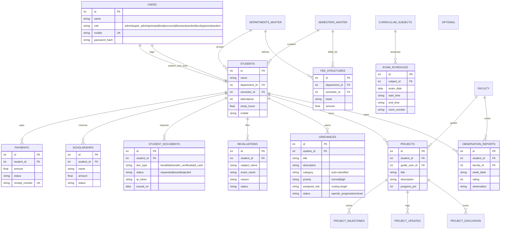

# Entity-Relationship Map

Core tables and the feature tables added by the admin/operations package.
All tables live in a single SQLite database (`backend/student_system.db`) and are
created idempotently via `backend/migrate.py` / module import.

## Relationship notes

- **finance**: a student's *assessed* amount = `SUM(fee_structures.amount)` for their
  department/semester; *paid* = completed `payments` + approved `scholarships`;
  *dues* = assessed − paid. `payments.receipt_number` is generated
  (`printf('RC%05d', id)`).
- **certificates**: `qr_token` (uuid hex) is set on issue and rendered on the student
  portal via `qrcodejs`.
- **grievances**: `category`, `priority` and `assigned_role` are produced by the
  keyword classifier in `routes/ai_ops.py`; each role's portal shows only its queue.
- **users.role** was widened beyond the original `('admin','student','faculty')`
  CHECK constraint during the role-support migration (see `routes/staff.py`).