# 🎓 Smart Campus AI – Intelligent Campus Management & Student Assistance SaaS

[](https://nodejs.org/)
[](https://ai.google.dev/)
[](https://expressjs.com/)
[-blue.svg)](https://nodejs.org/api/sqlite.html)
[](https://github.com/gauravranpishiya21/ai-smart-campous-and-student-assistance/actions/workflows/test.yml)
[](#-frontend-ux--design-system)
[-success.svg)](#-automated-testing--ai-evaluations)
[](LICENSE)

An enterprise-grade, full-stack Smart Campus SaaS platform engineered for higher education institutions. Powered by **Google Gemini AI (`gemini-3.8-flash`)**, high-performance **native SQLite (`node:sqlite`) with Write-Ahead Logging (WAL)**, strict **Role-Based Access Control (RBAC)**, session-bound QR attendance intelligence, predictive student dropout risk modeling, and a responsive **Progressive Web Application (PWA)** frontend.

---

## 📑 Table of Contents

1. [System Overview & What Makes It Stand Out](#-system-overview--what-makes-it-stand-out)
2. [Technology Stack](#-technology-stack)
3. [Simulated vs. Real Production Capabilities](#-simulated-vs-real-production-capabilities)
4. [Core Feature Modules](#-core-feature-modules)
5. [User Roles & Access Matrix](#-user-roles--access-matrix)
6. [System Architecture](#-system-architecture)
7. [Backend Foundation & Security Hardening](#-backend-foundation--security-hardening)
8. [Central Google Gemini AI Service](#-central-google-gemini-ai-service)
9. [Frontend UX & Design System](#-frontend-ux--design-system)
10. [Annual Academic Calendar & Institutional Mechanism](#-annual-academic-calendar--institutional-mechanism)
11. [Database Schema & Migration Layer](#-database-schema--migration-layer)
12. [REST & Streaming API Reference](#-rest--streaming-api-reference)
13. [Quickstart & Local Installation](#-quickstart--local-installation)
14. [Automated Testing & AI Evaluation Suite](#-automated-testing--ai-evaluation-suite)
15. [Known Limitations & Planned Hardening](#-known-limitations--planned-hardening)
16. [Troubleshooting & Common Issues](#-troubleshooting--common-issues)
17. [Production Deployment Guidelines](#-production-deployment-guidelines)
18. [Repository Structure & Cleanliness Invariant](#-repository-structure--cleanliness-invariant)

---

## 🌟 System Overview & What Makes It Stand Out

Smart Campus AI moves beyond standard campus administrative CRUD software by weaving generative AI, auditability, and operational automation directly into core institutional workflows:

- **Central AI Service (`gemini-3.8-flash`)**: All AI capabilities are governed through a single secure gateway (`server/services/gemini.js`) featuring 20s request timeouts, exponential backoff retries, per-user sliding window rate limiting (20 req/min), token audit logging in SQLite (`ai_usage` table), and seamless offline fallbacks.
- **RAG Chatbot with Document Citations**: Ingests university notices, syllabi, and administrative regulations into chunked vector embeddings stored in SQLite, returning grounded answers with verifiable sources.
- **Strict Role-Bound Function Calling**: Students can query personal data ("How many classes can I skip?", "What are my fee dues?") through AI function execution that accesses data strictly for the verified authenticated user (`req.user.id`), eliminating IDOR and role spoofing vulnerabilities.
- **Early-Warning Dropout & Performance Prediction**: Real-time analytical engine combining attendance deficits, internal CIA assessments, and assignment completion into composite risk levels (Low, Moderate, Critical) complete with Gemini-generated explanatory interventions.
- **Streaming AI Chat over SSE**: Real-time token streaming (`POST /api/ai/chat-stream`) via Server-Sent Events with client-side Markdown rendering sanitized with DOMPurify, copy action feedback, regenerate buttons, and live engine status badges.
- **Real Faculty Sessions & Single-Use Rolling QR Tokens**: Faculty open a class session for a specific subject and room. QR tokens are issued only by faculty, stored server-side in SQLite, expire strictly in 20 seconds, and are single-use. Students cannot mark attendance without an active faculty session. (Face recognition and RFID card taps are provided as interactive demo simulations.)
- **Intervention Loop & Email Channel**: Faculty log mentor notes, recovery action plans, and track risk trends over time (`POST /api/sessions/interventions`). Low-attendance warning notices are dispatched to parents via real email/SMS delivery logging.
- **10-Stage Institutional Working Mechanism**: UGC/AICTE-compliant 90-day semester calendar across Years 1 to 4 with interactive milestones and RFC 5545 `.ics` export.

---

## 💻 Technology Stack

| Layer | Component | Version / Specification | Purpose |
|---|---|---|---|
| **Runtime** | Node.js | `>=22.13.0` | Native ES modules, built-in `node:sqlite`, zero native build dependencies |
| **Backend Framework** | Express | `v5.3.0` | Modern routing, error-handling middleware, unified JSON responses |
| **Database** | SQLite 3.45 | Built-in `node:sqlite` (`DatabaseSync`) | Zero C++ compiling; WAL mode; Foreign Keys ON; `busy_timeout=5000` |
| **Generative AI** | Google Gemini | `@google/genai` (`gemini-3.8-flash`) | RAG chatbot, function calling, early-warning risk, study tools, triage |
| **Validation** | Zod | `v4.6.7` | Strict runtime request body & parameter schemas with HTTP 422 errors |
| **Security** | Helmet & bcryptjs | `helmet v8.3.0`, `bcryptjs v3.0.3` | CSP, XSS protection, nosniff headers, secure salt-hashed passwords |
| **Auth & Tokens** | JSON Web Tokens | `jsonwebtoken v9.0.3` | Cryptographically signed bearer tokens with $\ge 32$-character secrets |
| **Realtime** | Socket.IO & SSE | `socket.io v4.8.4` & Server-Sent Events | Live dashboard telemetry & streaming token-by-token AI responses |
| **Styling & UI** | Tailwind CSS | `v3.4.19` & `public/css/tokens.css` | Custom CSS tokens, responsive layout, dark/light mode toggle, PWA |
| **Sanitization** | DOMPurify | `v3.x` (Local bundle) | Client-side HTML sanitization preventing XSS attacks in rendered Markdown |
| **Job Scheduling** | node-cron | `v4.6.0` | Background attendance audits, fee reminders, daily metric calculations |

---

## ⚖️ Simulated vs. Real Production Capabilities

To provide absolute transparency for academic evaluation and production audits, the system clearly delineates real production backend mechanics from simulated browser demos:

| Feature Area | Implementation Status | Implementation Details |
|---|---|---|
| **Faculty Class Sessions** | 🟢 **Real Production** | `class_sessions` SQLite table. Faculty must open a session for subject/room before students can mark attendance. |
| **Rolling QR Code Attendance** | 🟢 **Real Production** | Cryptographic random tokens stored server-side in `session_qr_tokens`, strictly single-use, 20-second TTL. |
| **Manual Faculty Override** | 🟢 **Real Production** | Faculty can mark/correct attendance (`POST /api/sessions/:id/mark-manual`), logging every change to `audit_log`. |
| **Face Recognition Attendance** | 🟡 **Interactive Demo** | Simulated via frontend video canvas and liveness challenge. In production, connects to an OpenCV / Python face recognition service. |
| **RFID / NFC Card Tap** | 🟡 **Interactive Demo** | Simulated contactless card reader with badge ID lookup. In production, interfaces with physical NFC readers over serial/USB. |
| **RAG Campus Advisor** | 🟢 **Real Production** | Vector chunks in `document_chunks` table, semantic cosine lookup, grounded prompt synthesis with source citations. |
| **AI Function Calling** | 🟢 **Real Production** | Dynamic schema execution querying personal attendance, dues, and timetable strictly bound to verified `req.user.id`. |
| **Dropout Risk Modeling** | 🟢 **Real Production** | Quantitative weighted mathematical model + Gemini-generated narrative explanation and 3-step recovery roadmap. |
| **Database Transactions** | 🟢 **Real Production** | Atomic SQLite transactions (`withTransaction`) rolling back multi-statement writes on failure. |
| **Parent Email Dispatches** | 🟢 **Real Production / SMTP Ready** | Logs deliveries to `email_logs` table; transmits via SMTP if `SMTP_HOST` credentials are configured in `.env`. |
| **Resource Booking & IoT Power** | 🟡 **Interactive Demo** | Realistic occupancy and energy kilowatt telemetry simulations with active scheduling collision checks. |

---

## 📦 Core Feature Modules

### 1. Student Assistance & Intelligence
- **RAG Campus Advisor**: Natural language question-answering over campus regulations, exam schedules, fee circulars, and course syllabi with citations.
- **Personalized Executive Dashboard**: Real-time "Today" view across 25 canonical sections displaying the next upcoming lecture, attendance status, assignment countdowns, pending fee dues, and daily AI study tips.
- **Course & Career Advisor**: Dynamic study routines, elective recommendations based on academic history, and ATS resume scoring with structural suggestions.
- **Academic Doubt-Solving Assistant**: Interactive concept explanations mapped to syllabus modules.

### 2. Smart Attendance Intelligence
- **Tri-Modal Capture**: Biometric face detection (demo simulation), server-bound single-use rolling QR codes (20s expiry, tied to faculty-opened sessions — students cannot self-report without a real session), and contactless NFC/RFID badge tap simulation.
- **Faculty Session Control**: Faculty open a class session per subject and room. Only faculty can issue QR tokens; tokens expire after 20 seconds and are single-use. Each QR scan updates attendance per subject session.
- **Automatic Attendance Defense**: Automated warning dispatches to students and parents when subject attendance dips below the 75% regulatory threshold.
- **Skippable Classes Calculator**: Bunk calculator computing how many lectures a student can safely skip or must attend to attain 75% or 80%.

### 3. Academic & Examination Operations
- **Conflict-Free Timetable Generator**: Constraint Satisfaction Problem (CSP) solver detecting faculty, classroom, and slot collisions automatically.
- **Assignment Submission & AI Rubric Grading**: Digital submission portal with automated rubric-based grading feedback.
- **Academic Transcript & Hall Ticket Generator**: UGC-compliant SGPA/CGPA grade sheet computation with instant hall ticket issuance.
- **Study Materials Repository**: Departmental notes, question banks, and lecture slides filtered by semester and course.

### 4. Performance Analytics & Dropout Risk Prediction
- **Predictive ML Risk Scoring**: Evaluates attendance patterns, internal CIA marks, and deadline adherence to forecast student performance.
- **AI Explanatory Interventions**: Gemini generates actionable study advice and remediation plans for students tagged as "At Risk".
- **Faculty Mentorship Loop**: Faculty record follow-up notes, action plans, and track longitudinal risk trends (`GET /api/sessions/interventions/:studentId`).

### 5. Campus Living Services
- **Digital Library**: Catalog search, self-service borrow/return workflows, and overdue fee calculations.
- **Hostel & Mess Management**: Room allocation records, maintenance requests, and weekly cafeteria menus.
- **Live Transport Tracking**: Campus bus route tracking with ETA indicators and driver directory.
- **Fee Payment & Ledger**: Transparent fee breakdowns, payment recording, and downloadable receipts.
- **Campus Bulletin & Event Feed**: Category-filtered notices with AI auto-summaries.

### 6. Safety, Security & Facilities
- **Visitor Gate Management**: Digital visitor pass generation and check-in/out verification.
- **Emergency SOS Geo-Dispatch**: Instant one-click SOS distress dispatch broadcasting user location to security command.
- **Resource Booking**: Automated reservation management for seminar halls, chemistry labs, and sports complexes.
- **Simulated IoT Telemetry**: Energy and smart lighting telemetry monitoring classroom power consumption.

### 7. Grievance & Helpdesk Triage
- **AI Helpdesk Auto-Triage**: Analyzes student complaints to classify urgency, category, and sentiment with automated SLA tracking.
- **Student Wellness & Counseling**: Confidential counseling booking and wellness check-ins.

---

## 👥 User Roles & Access Matrix

| Role | Access Level & Key Capabilities | Required? |
|---|---|---|
| **Student** | Access personal dashboard (25 canonical views), RAG assistant, session QR attendance check-in, assignment portal, fee ledger, study tools, and SOS alerts. Cannot access administrative records or modify peers' data. | **Yes** |
| **Faculty** | Open/close class sessions, issue rolling QR tokens, mark or correct session attendance, grade assignments, review student risk alerts, log intervention notes, and upload study materials. | **Yes** |
| **Admin** | Comprehensive administrative console (`/admin.html`), student/faculty lifecycle provisioning, fee ledger moderation, system automation daemons, and immutable security audit logs (`audit_log`). | **Yes** |
| **Parent** | Monitor ward's real-time attendance percentage, exam report cards, and automated fee/attendance deficit email notifications. | *Optional* |
| **Security / Staff** | Verify visitor gate passes, log campus ingress/egress, and respond to SOS emergency dispatches. | *Optional* |

---

## 🏗️ System Architecture

```
┌─────────────────────────────────────────────────────────────────────────────────────────────┐
│                                       Client Layer (Browser / PWA)                          │
│   - Unified Student Portal (public/index.html - 25 views) - Admin Console (admin.html)      │
│   - CSS Design Tokens (tokens.css) & Dark Mode Toggle     - Hash Router (#/attendance, etc) │
│   - Streaming SSE AI Chat Controller (chat.js)            - DOMPurify Sanitizer & PWA SW    │
└──────────────────────────────────────────────┬──────────────────────────────────────────────┘
                                               │ HTTPS REST / Server-Sent Events (SSE) / WSS
                                               ▼
┌─────────────────────────────────────────────────────────────────────────────────────────────┐
│                                   Express 5 API & Security Layer                            │
│   - Helmet Security Headers & Strict CORS       - fail-fast config.js (JWT_SECRET >= 32 ch) │
│   - Trust Proxy IP Rate Limiter                 - Structured Logging (Pino + req.id)        │
│   - Unified Error Handler ({ error: {code} })  - Zod Request Validation Middleware          │
│   - Verified JWT Bearer Authentication Guard    - Strict Role-Based Access Control (RBAC)   │
└───────────────────────┬──────────────────────────────────────────────┬──────────────────────┘
                        │                                              │
                        ▼                                              ▼
┌──────────────────────────────────────────────┐     ┌────────────────────────────────────────┐
│     Central Google Gemini Service            │     │          Internal Domain Engines       │
│     (server/services/gemini.js)              │     │  - Central Kernel Core Execution       │
│  - Single Google GenAI Gateway               │     │  - Faculty Class Sessions & QR Tokens  │
│  - Model: gemini-3.8-flash                   │     │  - Academic Calendar 10-Stage Engine   │
│  - 20s Timeout & Exponential Retry (2x)      │     │  - Timetable CSP Conflict Solver       │
│  - Per-User Rate Limiter (20 req/min)        │     │  - Attendance & Bunk Math Engine       │
│  - Structured JSON Output & Offline Fallback │     │  - Mentorship Intervention Loop        │
└───────────────────────┬──────────────────────┘     └────────────────┬───────────────────────┘
                        │                                             │
                        └──────────────────────┬──────────────────────┘
                                               ▼
┌─────────────────────────────────────────────────────────────────────────────────────────────┐
│                                  Persistence & Storage Layer                                │
│   - Native Node SQLite 3.45 Engine (node:sqlite DatabaseSync - zero native C++ compilation) │
│   - Write-Ahead Logging (WAL) Mode, PRAGMA foreign_keys = ON, PRAGMA busy_timeout = 5000   │
│   - schema_migrations Table & Automatic Migration Runner (server/db/migrations/)           │
│   - audit_log Table (immutable audit trail for overrides, grading, and fee edits)           │
│   - class_sessions & session_qr_tokens (single-use 20s rolling QR codes)                   │
│   - ai_usage Audit Logging Table (tracks user_id, feature, tokens, latency, errors)         │
│   - document_chunks Table (RAG knowledge base with stored vector embeddings)                │
└─────────────────────────────────────────────────────────────────────────────────────────────┘
```

---

## 🔒 Backend Foundation & Security Hardening

### 1. Robust Configuration & Fail-Fast Startup (`server/config.js`)
- Validates all environment variables once at server startup.
- Halts execution immediately (`process.exit(1)`) if `JWT_SECRET` is missing or shorter than 32 characters, preventing insecure cryptographic deployments.

### 2. Standardized Error Handling (`server/middleware/error.js`)
- All uncaught and operational errors are formatted into a deterministic schema:
  ```json
  {
    "error": {
      "code": "BAD_REQUEST",
      "message": "Detailed error message"
    }
  }
  ```
- Strips internal call stacks in production mode.

### 3. Zod Request Validation (`server/middleware/validate.js`)
- Strict type validation on all incoming payloads for `POST /api/auth/login`, `POST /api/auth/register`, student profile updates, timetable checks, study tools, sessions, and admin overrides.
- Returns `422 VALIDATION_ERROR` with path-specific error messages.

### 4. Enterprise Security Safeguards
- **Helmet**: Injects hardened HTTP response headers (`X-Content-Type-Options: nosniff`, `X-Frame-Options: SAMEORIGIN`, `X-XSS-Protection: 1; mode=block`, `Referrer-Policy: strict-origin-when-cross-origin`).
- **Strict CORS**: Restricts unauthorized cross-origin resource sharing.
- **Trust Proxy & Rate Limiting**: Accurate IP rate limiting configured behind reverse proxies to prevent credential stuffing.
- **Health Check**: Non-blocking `/api/health` monitoring memory usage, SQLite WAL state, and uptime.
- **Pagination**: All list queries enforce safe pagination (`limit` and `offset`), preventing unbounded database scans.
- **Structured Logging**: High-performance logging powered by `pino` with unique correlation `req.id` tagged onto every request.

---

## 🤖 Central Google Gemini AI Service

All generative AI capabilities run through `server/services/gemini.js` using the official Google Gen AI SDK (`@google/genai`).

### Key Operational Characteristics
1. **Model Standard**: Defaulted to Google's current `gemini-3.8-flash` model via the `GEMINI_MODEL` environment variable.
2. **Single Gateway Architecture**: No external file calls `@google/genai` directly. All endpoints invoke the central service.
3. **Resilience & Fault Tolerance**:
   - 20-second abort timeout per call.
   - Automatic exponential backoff retries (up to 2 retry attempts) on network transient errors.
   - Built-in per-user sliding window rate limiting (20 requests per minute).
   - **Seamless Offline Fallback**: If `GEMINI_API_KEY` is omitted, quota is exhausted (`429 RESOURCE_EXHAUSTED`), or an API timeout occurs, the system automatically fulfills the request using intelligent built-in heuristics and indexed knowledge rules without throwing 500 errors.
4. **Structured JSON Output**: System prompts guarantee strictly parseable JSON for planner tasks, quiz generation, resume evaluation, and rubric grading.
5. **Usage Audit Logging (`ai_usage` table)**:
   Every request records `user_id`, `feature`, `tokens`, `latency`, `error`, and timestamp in SQLite for institutional analytics and compliance.

---

## 🎨 Frontend UX & Design System

The student portal UI (`public/index.html`) exposes 25 canonical views with a modern, responsive architecture:

- **Unified Design Tokens (`public/css/tokens.css`)**:
  Consistent CSS custom properties for color palettes (primary indigo, neutral slates, state alerts), spacing scales, corner radii, elevation shadows, focus rings, and shimmer skeleton loaders.
- **Light & Dark Mode**:
  Seamless theme switching toggle (`#themeToggleBtn`) supporting system preference detection (`prefers-color-scheme`) and persistent preference caching in `localStorage`.
- **Modular ES JavaScript Architecture**:
  The interface is decoupled into dedicated, lazy-loaded controllers in `public/js/modules/`:
  - `router.js`: Handles hash routing (`#/attendance`, `#/calendar`, `#/timetable`, `#/chat`, etc.), script loading, recent sections tracking, and pinned navigation shortcuts.
  - `dashboard.js`: Manages the executive "Today" view (next class, attendance status, upcoming deadlines, fee dues, and daily AI tips).
  - `attendance.js`: Subject breakdown, 75% rule audit, and skippable/required lecture math.
  - `calendar.js`: Interactive 10-stage annual academic calendar with 90-day UGC mandate validation and `.ics` export.
  - `timetable.js`: Weekly lecture slot grids and classroom locations.
  - `chat.js`: Streaming SSE chat, Markdown rendering via DOMPurify, suggested quick-prompts, animated copy button, regenerate responses, and dual-mode indicator badge (`✨ Gemini 3.8 Flash Active` vs `⚡ Offline Mode`).
  - `study-tools.js`: Interactive quizzes, flashcard flipping, and revision trackers.
  - `fees.js`: Tuition breakdown, transaction records, and payment receipts.
  - `helpdesk.js`: AI-classified ticket submission, status filters, and resolution timers.
  - `library.js`: Borrowed book ledger, renewals, and catalog search.
  - `profile.js`: Student credentials, cohort details, and academic standing.
- **Shared UI Helpers (`public/js/helpers.js`)**:
  - `toast(message, type, duration)`: Non-intrusive animated notification toasts.
  - `skeleton(type)`: Shimmer loading placeholders preventing blank screen flicker.
  - `emptyState(title, description, icon)`: Elegant empty states for missing records.
  - `confirmDialog({ title, message, confirmText, cancelText })`: Accessible modal confirmation dialogs.
  - `attachInlineValidation(form, schema)`: Instant visual validation on form inputs.
- **Sidebar Global Search (Ctrl+K)**:
  Instant fuzzy search across all 25 campus modules, recently visited sections, and pinned shortcuts.
- **Mobile Bottom Navigation Bar**:
  Fixed bottom navigation bar (`#mobileBottomNav`) for seamless phone and tablet navigation.
- **Progressive Web App (PWA)**:
  `manifest.json` and `public/sw.js` provide offline shell caching, installable web app capabilities, and network resilience.

---

## 📅 Annual Academic Calendar & Institutional Mechanism

Smart Campus AI implements a UGC/AICTE-aligned **10-Stage Institutional Working Mechanism** for all 4 academic years (Years 1–4, Semesters 1–8):

```mermaid
flowchart LR
    S1[Stage 1: Curriculum Planning] --> S2[Stage 2: Orientation & Registration]
    S2 --> S3[Stage 3: 90-Day Academic Delivery]
    S3 --> S4[Stage 4: Mid-Semester Review]
    S4 --> S5[Stage 5: Continuous Internal Assessment]
    S5 --> S6[Stage 6: Remedial Mentoring]
    S6 --> S7[Stage 7: End-Semester Examinations]
    S7 --> S8[Stage 8: Result Moderation & SGPA]
    S8 --> S9[Stage 9: Faculty Development Program]
    S9 --> S10[Stage 10: Semester Break & Transition]
```



### Calendar Capabilities:
- **90-Day Working Day Mandate**: Built-in verification guaranteeing at least 90 effective instructional days per semester.
- **Stage Progression & Milestones**: Interactive timeline displaying active semester phases, critical cutoffs, and examination windows.
- **RFC 5545 iCalendar (.ics) Export**: One-click download (`GET /api/calendar/ics?year=2`) enabling students to sync the institutional calendar with Google Calendar, Apple Calendar, or Microsoft Outlook.

---

## 🗄️ Database Schema & Migration Layer

The persistence layer uses Node.js 22's built-in `node:sqlite` (`DatabaseSync`), operating with **Write-Ahead Logging (WAL)**, `PRAGMA foreign_keys = ON`, and `PRAGMA busy_timeout = 5000`.

### Migration Runner
Schema changes are managed via numbered SQL migration files in `server/db/migrations/` and tracked in the `schema_migrations` table:
- `001_audit_log.sql`: Adds `audit_log`, `schema_migrations`, performance indexes, and SQLite pragmas.

### Core Tables & Schemas

| Table | Primary Columns & Types | Description |
|---|---|---|
| `users` | `id` (PK), `roll_no`, `name`, `email`, `password_hash`, `dept`, `year`, `semester`, `role`, `phone`, `bio`, `created_at` | Core user accounts with role-based access flags. |
| `class_sessions` | `id` (PK), `faculty_id`, `subject_id`, `room`, `date`, `slot`, `status`, `created_at` | Faculty-managed classroom sessions for attendance. |
| `session_qr_tokens` | `id` (PK), `session_id`, `token` (Unique), `expires_at`, `used_by`, `used_at`, `created_at` | Single-use 20-second rolling QR tokens bound to a class session. |
| `audit_log` | `id` (PK), `user_id`, `action`, `table_name`, `record_id`, `old_value`, `new_value`, `ip_address`, `created_at` | Immutable security audit trail for sensitive administrative operations. |
| `intervention_notes` | `id` (PK), `student_id`, `faculty_id`, `note`, `action_plan`, `follow_up_date`, `status`, `risk_level` | Mentorship follow-up notes and recovery plans. |
| `email_logs` | `id` (PK), `to_address`, `subject`, `body`, `type`, `status`, `provider`, `created_at` | Delivery ledger for parent and student alert emails. |
| `attendance` | `user_id` (PK), `subject_id` (PK), `attended`, `total` | Aggregate attendance counter per student and subject. |
| `attendance_log`| `id` (PK), `user_id`, `date`, `status`, `method` | Granular daily log with capture method (QR, Face, NFC, Standard). |
| `marks` | `user_id` (PK), `subject_id` (PK), `internal`, `endsem`, `assign_done`, `assign_total` | Continuous Internal Assessment (CIA) and semester scores. |
| `notices` | `id` (PK), `title`, `body`, `summary`, `category`, `priority`, `target_year`, `target_dept`, `created_at` | Campus bulletins with AI summaries and demographic filtering. |
| `notifications`| `id` (PK), `user_id`, `message`, `type`, `dedupe` (Unique), `created_at` | In-app alerts with deduplication hashing. |
| `ai_usage` | `id` (PK), `user_id`, `feature`, `tokens`, `latency`, `error`, `created_at` | Real-time audit log of all generative AI executions. |
| `document_chunks`| `id` (PK), `source`, `title`, `chunk`, `embedding`, `metadata`, `created_at`| RAG document store holding chunked campus knowledge. |

---

## 📡 REST & Streaming API Reference

### 1. System Health & Authentication
- `GET /api/health` – System status, memory usage, and uptime.
- `POST /api/auth/login` – Authenticate with roll number/email and password (Rate limited, Zod validated).
- `POST /api/auth/register` – Register a new student account.
- `GET /api/auth/me` – Fetch authenticated user profile via verified JWT.

### 2. Generative AI & Streaming
- `GET /api/ai/status` – Inspect AI engine state, active model (`gemini-3.8-flash`), and offline mode status.
- `POST /api/ai/chat-stream` – **Streaming SSE AI Chat** with real-time token delivery.
- `POST /api/ai/chat` – Synchronous RAG campus query with source citations.
- `POST /api/ai/doubt` – Syllabus-mapped academic doubt solving.
- `POST /api/ai/planner-chat` – Structured 6-day study plan generation.
- `POST /api/ai-engine` – Central Kernel Core execution engine (Protected behind verified JWT).
- `POST /api/ai/kernel-execute` – Direct verified kernel command dispatcher.

### 3. Faculty Class Sessions & Real QR Attendance
- `POST /api/sessions/open` – **Faculty Only**. Open an instructional session for subject and room.
- `GET /api/sessions/:id/qr` – **Faculty Only**. Generate a single-use 20-second rolling QR code token.
- `POST /api/sessions/attend` – **Student Only**. Scan and consume a valid, unexpired session QR token.
- `POST /api/sessions/:id/mark-manual` – **Faculty Only**. Manually record/correct student attendance.
- `POST /api/sessions/:id/close` – **Faculty Only**. Close an instructional session.
- `GET /api/sessions/at-risk` – **Faculty Only**. List students below 75% attendance for taught courses.
- `POST /api/sessions/interventions` – **Faculty Only**. Record a mentor follow-up note and recovery plan.
- `GET /api/sessions/interventions/:studentId` – View student intervention history and risk trend.
- `POST /api/sessions/alert-email` – Send attendance warning email to parents/students.

### 4. Smart Attendance & Academics
- `GET /api/attendance` – Personal subject attendance breakdown and skippable lecture calculations.
- `POST /api/attendance/mark` – Standard daily attendance self-check-in (Transaction-wrapped).
- `GET /api/results` – SGPA/CGPA transcript and marks breakdown.
- `GET /api/calendar/annual?year=2` – Annual working mechanism schedule and milestones.
- `GET /api/calendar/ics?year=2` – RFC 5545 `.ics` downloadable calendar export.
- `POST /api/academic/timetable-conflict-check` – Detect faculty/room booking collisions.
- `POST /api/academic/generate-timetable` – Generate semester schedule.

### 5. Executive Administration (`/api/admin/*`, Admin Role Only)
- `GET /api/admin/overview` – Campus KPI analytics, attendance radar, and fee collection telemetry.
- `GET /api/admin/students` – Complete student directory with risk ratings.
- `POST /api/admin/students` – Provision new student, faculty, or administrator accounts.
- `PUT /api/admin/students/:id` – Update user details or role permissions.
- `DELETE /api/admin/students/:id` – De-provision student and cascade associated records.
- `POST /api/admin/attendance/override` – Administrative attendance ledger override (Audited).
- `POST /api/admin/marks/update` – Update CIA and semester grades (Audited).
- `POST /api/admin/automation/run` – Manually trigger background automation daemons.

---

## 🚀 Quickstart & Local Installation

### Prerequisites
- **Node.js**: `v22.13.0` or higher (Uses native `node:sqlite` without needing C++ build tools like `node-gyp`).
- **Web Browser**: Chrome, Edge, Safari, or Firefox.

### 1. Clone the Repository
```bash
git clone https://github.com/gauravranpishiya21/ai-smart-campous-and-student-assistance.git
cd ai-smart-campous-and-student-assistance
```

### 2. Install Dependencies
```bash
npm install
```

### 3. Configure Environment Variables
Copy `.env.example` to `.env`:
```bash
cp .env.example .env
```

| Variable | Required? | Default | Description |
|---|---|---|---|
| `PORT` | Optional | `3000` | HTTP port on which the Express application listens |
| `NODE_ENV` | Optional | `development` | Environment mode (`development` or `production`) |
| `JWT_SECRET` | **Required** | — | Cryptographic secret key ($\ge 32$ characters) for signing JWTs |
| `GEMINI_API_KEY` | Optional | `""` | Google Gemini API key from Google AI Studio |
| `GEMINI_MODEL` | Optional | `gemini-3.8-flash` | Active Gemini model standard |
| `DB_FILE` | Optional | `data/campus.db` | Custom file path for SQLite database |
| `CORS_ORIGIN` | Optional | `""` (Allow all in dev) | Allowed origins for cross-origin requests |
| `TRUST_PROXY` | Optional | `1` | Enable reverse proxy IP forwarding for rate limiters |
| `LOG_LEVEL` | Optional | `info` | Logging verbosity (`fatal`, `error`, `warn`, `info`, `debug`) |
| `AUTOMATION` | Optional | `true` | Enable or disable background node-cron automation jobs |
| `SMTP_HOST` | Optional | `""` | SMTP hostname for real email dispatches (e.g. `smtp.gmail.com`) |
| `SMTP_PORT` | Optional | `587` | SMTP port |
| `SMTP_USER` | Optional | `""` | SMTP username |
| `SMTP_PASS` | Optional | `""` | SMTP password / app key |
| `ALERT_FROM_EMAIL`| Optional | `alerts@smartcampus.edu`| Default outbound sender email address |

### 4. Verify Google Gemini Model
Run the built-in model verification script to confirm your Gemini model is active on Google's API:
```bash
npm run check:models
```

### 5. Seed the Database
Populate SQLite with realistic academic data (students, faculty, subjects, attendance, marks, notices, and RAG knowledge chunks):
```bash
npm run seed
```

### 6. Build CSS Assets
Compile the Tailwind CSS styles into `public/vendor/tailwind.css`:
```bash
npm run build:css
```

### 7. Start the Server
```bash
npm start
```
The server will boot up and listen at **`http://localhost:3000`**.

### 8. Database Backup & Reset Utilities
- **Safe Online Backup** (uses `VACUUM INTO` without locking SQLite):
  ```bash
  npm run backup
  ```
- **Development Database Reset & Reseed**:
  ```bash
  npm run reset-db -- --yes
  ```

### 9. Demo Accounts

| Role | Portal URL | Login Identifier | Password |
|---|---|---|---|
| **Student** | `http://localhost:3000` | `2024CS0042` (or `test@smartcampus.edu`) | `student123` |
| **Faculty** | `http://localhost:3000` | `FACULTY001` | `student123` |
| **Administrator** | `http://localhost:3000/admin.html` | `ADMIN001` | `student123` |

---

## 🧪 Automated Testing & AI Evaluation Suite

The application includes an automated test runner executing **79 comprehensive checks (100% pass)**:

```bash
npm test
```

### Test Coverage Breakdown:
1. **Authentication Tests (6 checks)**: Bad credentials rejection, JWT issuance, persistence across reboots, expired/invalid token handling.
2. **Authorization & Security Tests (6 checks)**: Unauthenticated AI rejection (Issue #1 fix), role-spoofing rejection, student privilege escalation interception (`AUTHORIZATION_BREACH`), admin route guards, IDOR ownership isolation, and Helmet headers.
3. **Central Google Gemini AI Tests (8 checks)**: Model configuration, mock client generation, 429 quota exhaustion fallback, 20s timeout handling, invalid key handling, and rate limiting (20 req/min).
4. **End-to-End Application Regression Suite (8 checks)**: Telemetry, timetable generation, marks, fee ledgers, library, notices, and bookings.
5. **Database Layer Tests (7 checks)**: `audit_log` inserts, transaction rollback on failure, faculty session creation, student session restriction (RBAC), expired QR token rejection, `schema_migrations` table existence, and session table existence.
6. **Step 4: Intervention Loop & Email Alerts (3 checks)**: Faculty mentor note recording, student risk trend retrieval, and email alert logging.
7. **Repository Cleanliness Check (1 check)**: Root directory contains strictly config files and approved directories.
8. **DOM Integrity & Reachability (8 checks)**: 0 duplicate DOM IDs across all views, 100% reachability across 25 student sections, 0 broken 404 assets.
9. **Comprehensive AI Benchmark & Security Suite (32 checks)**:
   - Part 1: RAG Chatbot Benchmark (5 questions with citations).
   - Part 2: Role-Bound Function Calling (5 personal questions).
   - Part 3: Early-Warning Risk Prediction & Diagnostic Roadmap.
   - Part 4: Educational Quiz & Flashcard Generation.
   - Part 5: Helpdesk Ticket Triage (Category, Urgency, SLA).
   - Part 6: Prompt-Injection Attack Defense (4 attacks safely intercepted).
   - Part 7: Role-Spoofing & Privilege Defense (4 attacks blocked).
   - Part 8: Dual-Mode Execution (Verified seamless operation with and without API key).
   - Part 9: `ai_usage` SQLite Audit Logging.

---

## ⚠️ Known Limitations & Planned Hardening

1. **Face Recognition & RFID**: Face liveness and RFID taps operate currently as browser-based simulations for demonstration and user testing. Connecting to production edge hardware (CCTV RTSP streams or USB NFC readers) is planned for future enterprise releases.
2. **SQLite Concurrent Writers**: SQLite with WAL mode handles hundreds of concurrent readers easily, but writes are serialized. For deployments exceeding 10,000 active concurrent students, migrating to PostgreSQL with PgBouncer is recommended.
3. **AI Free Tier Quotas**: Google's free-tier Gemini API has daily request ceilings. The platform gracefully falls back to offline heuristic engines when quotas are exhausted, but production enterprise deployments should use a paid Gemini API tier.

---

## 🔧 Troubleshooting & Common Issues

- **Server exits at startup with `[FATAL CONFIG ERROR] JWT_SECRET`**:
  Ensure your `JWT_SECRET` in `.env` is at least 32 characters long.
  ```bash
  node -e "console.log(require('crypto').randomBytes(32).toString('hex'))"
  ```
- **Gemini API returns 429 Quota Exhausted**:
  The system automatically switches to offline mode with zero disruption. Check your daily limits on [Google AI Studio](https://aistudio.google.com/).
- **Database file locked (`SQLITE_BUSY`)**:
  `PRAGMA busy_timeout = 5000` is active. Ensure all long-running queries are paginated and background scripts don't hold persistent write locks.
- **Port 3000 already in use**:
  Set `PORT=3001` in your `.env` file or terminate stale node processes.

---

## 🚢 Production Deployment Guidelines

1. **Environment Configuration**:
   - Set `NODE_ENV=production`.
   - Set strong 64-character random string for `JWT_SECRET`.
   - Configure `GEMINI_API_KEY`, `CORS_ORIGIN`, and `TRUST_PROXY=1`.
2. **Reverse Proxy (Nginx / Caddy)**:
   - Deploy behind Nginx or Caddy with TLS 1.3 certificates.
   - Enable WebSocket upgrade headers for real-time notifications:
     ```nginx
     proxy_set_header Upgrade $http_upgrade;
     proxy_set_header Connection "upgrade";
     ```
3. **Database Maintenance & Backups**:
   - SQLite operates with Write-Ahead Logging (`PRAGMA journal_mode = WAL`).
   - Run daily backups using `npm run backup` without taking the service offline.

---

## 📁 Repository Structure & Cleanliness Invariant

The repository enforces a clean architectural separation. The root directory contains strictly configuration files, documentation, and primary folders:

```
c:\CornerStone/
├── .env.example              # Environment variables template
├── .gitignore                # Git ignore specifications
├── package.json              # Dependencies and lifecycle scripts
├── package-lock.json         # Pinned dependency lockfile
├── tailwind.config.js        # Tailwind CSS design system configuration
├── tailwind.input.css        # Tailwind custom styles and components
├── README.md                 # Primary system documentation
├── LICENSE                   # MIT Open Source License
├── SECURITY.md               # Vulnerability disclosure policy
│
├── .github/                  # Continuous Integration
│   └── workflows/
│       └── test.yml          # GitHub Actions CI automated test workflow
│
├── server/                   # Backend Application Code
│   ├── index.js              # Express 5 server & REST/SSE endpoint router
│   ├── sessions.js           # Faculty class sessions & rolling QR tokens
│   ├── config.js             # Validated configuration & fail-fast startup
│   ├── db.js                 # node:sqlite DatabaseSync layer, migrations, WAL
│   ├── logger.js             # Structured Pino logger with request ID tracing
│   ├── prompts.js            # Structured system prompts per AI feature
│   ├── seed.js               # Database seeder with realistic campus fixtures
│   ├── selftest.js           # Comprehensive automated test suite runner
│   ├── smartCampusSuite.js   # Timetable CSP engine & attendance math
│   ├── kernelEngine.js       # Central AI Kernel execution dispatcher
│   ├── academicCalendar.js   # 10-Stage institutional working calendar & ICS
│   ├── automation.js         # Node-cron background automation jobs
│   ├── db/
│   │   └── migrations/
│   │       └── 001_audit_log.sql # Initial database migration
│   ├── middleware/
│   │   ├── error.js          # Standardized error response handler
│   │   ├── pagination.js     # Unified limit/offset paginator
│   │   └── validate.js       # Zod request validation schemas
│   └── services/
│       ├── gemini.js         # Single Google Gemini gateway with offline fallback
│       ├── riskAdvisor.js    # Predictive risk scoring & mentor interventions
│       └── emailNotifier.js  # Low-attendance alert email dispatcher
│
├── public/                   # Client-Side Frontend (PWA)
│   ├── index.html            # Main student portal interface (25 canonical views)
│   ├── admin.html            # Executive administration console
│   ├── manifest.json         # Progressive Web App web manifest
│   ├── sw.js                 # Service Worker with offline shell caching
│   ├── css/
│   │   └── tokens.css        # Design tokens: palette, spacing, shadows, dark mode
│   ├── js/
│   │   ├── helpers.js        # UI utilities: toast, skeleton, confirmDialog, validator
│   │   └── modules/          # Lazy-loaded ES modules per functional domain
│   └── vendor/               # Client-side third-party dependencies
│       ├── tailwind.css      # Compiled Tailwind CSS bundle
│       ├── purify.min.js     # DOMPurify HTML sanitizer
│       ├── chart.umd.min.js  # Chart.js visualization engine
│       └── qrcode.min.js     # QR code rendering utility
│
├── data/                     # Database & File Assets (Ignored by Git)
│   └── campus.db             # SQLite WAL database file
│
├── docs/                     # Institutional & Technical Documentation
│   └── README.md             # Synchronized documentation mirror
│
├── tests/                    # Testing & Evaluation Suites
│   ├── dom_validation.test.js# DOM ID collision & reachability test
│   └── ai-eval/              # Generative AI Benchmarking & Defense Tests
│       ├── ai-eval.test.js   # 40-scenario benchmark & security test runner
│       └── eval-questions.json# Benchmark questions, prompts, and ground truth
│
└── scripts/                  # Administrative & Utility Scripts
    ├── backup.js             # Online SQLite VACUUM backup utility
    ├── reset-db.js           # Safe re-seed development utility
    └── list-models.mjs       # Google Gemini model verification script
```

---

## 📄 License

This project is licensed under the **MIT License**. See the [LICENSE](LICENSE) file for details.
